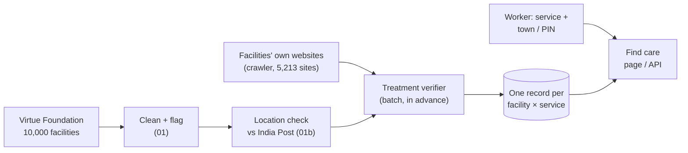
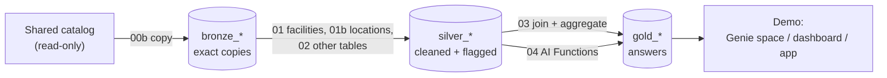

# databricks-fall2026-hackathon

> **CMU Datathon, Fall 2026: Find the right care.** Given a service (dialysis, emergency C-section, NICU, MRI…) and a location in India, recommend the best facilities and show the evidence behind each pick. Brief and checklist: [`docs/CHALLENGE.md`](docs/CHALLENGE.md).
>
> **What we built:** "Find care", a page where a community health worker or NGO coordinator picks a **service** (dialysis, cath lab, emergency department, CT, and 21 more) and types a **town, district or PIN code**. It gets nearby facilities, ranked by how well documented evidence supports that the facility offers the service, each with the exact quote and link behind it and how sure we are.

| Teammate | GitHub | Working on |
| --- | --- | --- |
| Brian | Aryushix | Data cleaning, location checks, treatment verification, symptom navigation and the Find care page |
| Maaz | MaazKashif789 | PIN directory and NFHS-5 cleaning (`02`), facility evidence table (`02b`) |
| Tanisha | TanishaKr07 | Care Finder orchestrator backend (`app/carefinder`, branch `tanisha/orchestrator`) |
| Abdullah | TODO | Care Finder React frontend and chatbot |

**In one line:** we copy the Virtue Foundation health data into our own Databricks schema, clean it (flagging every doubtful value instead of hiding it), check every facility's location, verify service claims against each facility's own website, and show each answer with its evidence.

## How it works



1. **Clean** (`01_clean_facilities`): 9,989 facilities, with a `dq_flags` column naming every doubtful value instead of hiding it. See `docs/DATA_CLEANING.md`.
2. **Check locations** (`01b_verify_locations`): each facility's PIN, city and coordinates are compared with India Post. The result is a point to measure from and a `location_confidence`. See `docs/LOCATION_CHECKS.md`.
3. **Crawl** (laptop only, `tools/facility_crawler.py`): we fetched each facility's own website, respecting `robots.txt`. 5,213 of 8,060 sites returned pages.
4. **Verify services in advance** (`src/hackathon/verification`; laptop CLI or notebook `07`):
   - Every facility × service pair gets one record: a status, a confidence score, the exact quotes behind it and their sources. That's 39,956 records for 4 services.
   - The app only looks these records up. Nothing is verified at request time.
   - Each verifiable service has a knowledge base (`src/hackathon/verification/kb/*.yaml`): the names that count, look-alikes that don't (CT angiography isn't a cath lab), and negations, outsourcing and referrals.
   - Statuses:
     - **CONFIRMED**: the facility's own website offers it, and the score is ≥ 0.90.
     - **LIKELY**: the dataset's text says so, but no website check passed.
     - **NOT CONFIRMED**: only look-alikes, another facility, or stale claims.
     - **CONTRADICTED**: a credible "not offered", "outsourced" or "discontinued".
     - **UNVERIFIED**: no evidence.
5. **Find care** (`app/pages/1_Find_care.py`, API in `navigation/api.py`):
   - The town or PIN becomes a point through India Post. Names in several states ask which one.
   - Verified facilities are ranked by status (CONFIRMED before LIKELY), then confidence band, then straight-line distance. The search is 100 km, widened once to 150 km.
   - Then comes a "call to check" list of nearby facilities whose capability isn't verified.

**Confidence** (`heuristic_v1`, `configs/verification.yaml`) is a hand-weighted log-odds score:

```
logit = prior(service, facility type)
      + 3.0 × Σ over independent sources of the strongest positive claim's strength
      − 3.0 × Σ over independent sources of the strongest negative claim's strength
      + min(2.4, prerequisites)
score = 1 / (1 + e^−logit)
```

A claim's strength = claim type × source reliability (own website 1.0, dataset text 0.5) × wording precision × recency × "is it this facility". The weights are set by hand, not fitted to labels, so the score orders results and isn't a probability. The page shows it as bands, and dataset text alone can never reach CONFIRMED. Details are in `docs/TREATMENT_VERIFICATION.md`.

**Numbers so far (counts and consistency checks, not accuracy):**

| Service | CONFIRMED | LIKELY | NOT CONFIRMED | UNVERIFIED |
| --- | ---: | ---: | ---: | ---: |
| Emergency department | 995 | 1,880 | 1,093 | 6,014 |
| Hemodialysis | 472 | 708 | 172 | 8,637 |
| CT scan | 362 | 1,048 | 949 | 7,621 |
| Cardiac catheterization | 88 | 331 | 600 | 8,970 |

- **Coverage:** at 71 sampled India Post locations (2 per state), a verified dialysis facility is within 100 km for 83% of them (92% within 150 km). For the emergency test cases, a verified match (mostly an emergency department) is within 50 km for 89–90%.
- **Consistency:** every recommendation's status matched the verifier's record (7,451 of 7,451).
- **Tests:** 400 automated tests pass.
- **Accuracy is not measured yet:** that needs people to label a sample. The plan is in `docs/verification_benchmark_design.md`.

**Known limits:**
- Only 4 services can be verified; the other 21 get the call-to-check list.
- Only about half the facilities have a crawlable website, so the rest can't be CONFIRMED.
- Distances are straight-line, not road.
- A result describes documented evidence. It isn't a guarantee that a service is available today.

### Run the demo

- **On Databricks:**
  1. Put `facilities_enriched.csv`, `facilities_verified.csv`, `verification/records.jsonl.gz` and `verification/summary.json` in `/Volumes/workspace/hackathon/raw/navigation/`.
  2. Create a Databricks App from this Git folder (`app.yaml` is ready).
  3. Open the "Find care" page.
- **On a laptop:**
  ```
  pip install -r requirements.txt
  NAV_DATA_DIR=~/hackathon-data streamlit run app/app.py
  ```
- **API:**
  ```
  PYTHONPATH=src uvicorn hackathon.navigation.api:app
  ```
  Endpoints: `GET /services`, `GET /resolve-location?q=Gaya`, `POST /find-facilities` with `{"service": "hemodialysis", "latitude": 18.52, "longitude": 73.86}`.

---

## Start here

| If you are... | Do this |
| --- | --- |
| **New to the team** | Steps 1 to 3 below (about 10 minutes) |
| **Setting up the data the first time** | Step 4 (one person, once) |
| **Back to keep working** | Click **Pull** in your Git folder, then open the notebook you own |

**1. Get into the workspace.** Ask Brian to add your email in the team's Databricks workspace, then sign in with that email.

**2. Link GitHub to Databricks.** Click your profile icon (top right) → **Settings → Linked accounts → Add Git credential** → **GitHub**. Either **Link Git account**, or paste a GitHub *classic* personal access token with the `repo` scope.

**3. Clone this repo into Databricks.** **Workspace** → your user folder → **Create → Git folder**:
- URL: `https://github.com/Aryushix/databricks-fall2026-hackathon.git`
- Provider: **GitHub**

**4. Load and clean the data (only once for the whole team).**
1. Open `notebooks/00b_load_virtue_foundation`, choose **Serverless** compute, click **Run all**. **Catalog → workspace → hackathon** now has three `bronze_` tables. If the notebook stays on **Waiting**, run `sql/load_data_sql_editor.sql` in the **SQL Editor** instead.
2. *Recommended:* upload the raw export `dataset.csv` to **Catalog → workspace → hackathon → raw** (never to GitHub). Without it, 30 facilities lose their capability and location fields (see `docs/DATA_CLEANING.md`).
3. Run `notebooks/01_clean_facilities`. It writes `silver_facilities`, one row per facility with a `dq_flags` column.
4. Run `notebooks/01b_verify_locations`. It checks every facility's PIN, city and coordinates against India Post and writes `silver_facilities_verified`: **build on this table**.

---

## How the data flows



| Layer | Tables | Made by | Rule |
| --- | --- | --- | --- |
| Source | 3 tables in **Shares received** | Virtue Foundation | Read-only. We never change it. |
| Bronze | `bronze_facilities`, `bronze_india_post_pincode_directory`, `bronze_nfhs_5_...` | `00b` | Exact copies, plus `_source_file` and `_ingested_at` |
| Silver | `silver_facilities` (+ `_dq_summary`) | `01` | Our facility cleaning rules; every doubtful value flagged in `dq_flags` |
| Silver | `silver_facilities_verified` (+ `_location_removed`) | `01b` | Location checked against India Post; best point to measure from; evidence sentence |
| Silver | `silver_<table>` for the other two tables | `02` | Fixed types, trimmed text, no duplicates |
| Silver | `silver_facility_evidence` | `02b` | One row per facility claim, from the cleaned lists, with `source_urls` to cite |
| Gold | `gold_<name>` | `03`, `04` | Joined and summarized tables the demo reads. Every table gets a `COMMENT`. |

**The three source tables:**
- `facilities`: health facility records from the Virtue Foundation.
- `india_post_pincode_directory`: India's postal codes (pincodes) with the district and state each one belongs to.
- `nfhs_5_district_health_...`: district-level health indicators from India's National Family Health Survey (NFHS-5, 2019–21).

The likely join path is **facility → pincode → district → NFHS-5 indicators**. Check this on the real columns. District names often differ in spelling between tables.

---

## What's in this repo

```
notebooks/
  00b_load_virtue_foundation.py  1. Copy the shared data into workspace.hackathon (run once)
  01_clean_facilities.py         2. Clean the facilities → silver_facilities, with data-quality flags
  01b_verify_locations.py        2b. Check each location against India Post → silver_facilities_verified
  02_clean_silver.py             3. Clean the PIN directory and NFHS-5 tables → silver_<table>
  02b_facility_evidence.py       3b. One row per facility claim (specialty, procedure, equipment, capability) → silver_facility_evidence
  03_gold_tables.sql             4. Join and summarize → gold_ tables (write our logic here)
  04_ai_enrich.sql               5. LLM functions on text columns: classify, extract, mask
  05_build_rag_index.py          Optional: search index for a chatbot over documents
  06_ask_and_evaluate.py         Optional: test the chatbot's answers
src/hackathon/
  config.py                      Every table, volume, and model name in one place
  cleaning.py                    The facility cleaning rules (used by notebook 01 and tools/)
  facility_silver.py             Notebook 01's helpers: pick the source, write typed tables
  location_check.py              Location checks against India Post (used by notebook 01b and tools/)
  verification/                  Does a facility provide a treatment? Evidence, status, confidence
  navigation/                    Symptoms + location -> safety advice and verified nearby facilities
  rag.py                         Chatbot logic, shared by notebook 06 and the app
tools/
  clean_dataset.py               Same cleaning on a laptop: dataset.csv → facilities_cleaned.csv
  facility_crawler.py            Optional, laptop only: fill missing contacts/years from facility websites
  verify_locations.py            Same location checks on a laptop, on a CSV
  verify_treatments.py           Treatment verification on a laptop, on a CSV
  eval_navigation.py             Evaluate symptom navigation (synthetic cases; optional real data)
tests/                           Tests for the cleaning and location rules (made-up rows, no real data)
app/app.py, app.yaml             Optional: demo chat app (Databricks Apps)
app/pages/1_Find_care.py         Find care: pick a service and a town / PIN, see facilities with their evidence
eval/questions.jsonl             Optional: test questions for notebook 06
data/README.md                   Where the data lives and where it came from (no data in Git)
sql/load_data_sql_editor.sql     Backup: load the data from the SQL Editor if notebooks won't start
docs/CHALLENGE.md                The datathon brief and our submission checklist
docs/DATA_CLEANING.md            Every cleaning rule and data-quality flag, with counts
docs/LOCATION_CHECKS.md          How each location is checked against India Post, with results
docs/TREATMENT_VERIFICATION.md   How treatment claims are verified, and how to run it
docs/SYMPTOM_NAVIGATION.md       Symptom navigation: how it decides, how to run, deploy and evaluate it
configs/verification.yaml        Thresholds, weights and source reliability for treatment verification
configs/red_flags.yaml, care_needs.yaml, symptom_terms.yaml, navigation.yaml   Symptom navigation rules (draft)
docs/databricks-tutorial.md      Our Databricks tutorial: cleaning, AI Functions, RAG, evaluation
.github/                         Automatic code check on every pull request
```

Notebook numbers show run order.

**Where things live:** code is in GitHub. Tables are in Databricks under `workspace.hackathon`, and everyone on the team shares them. Never commit data files.

---

## Running the notebooks

Always attach **Serverless** compute. AI Functions don't work on other compute.

| Notebook | Set these widgets (top of the notebook) | Output |
| --- | --- | --- |
| `00b_load_virtue_foundation` | Nothing | `bronze_` copies of all three tables |
| `01_clean_facilities` | Nothing. Put `dataset.csv` in the `raw` volume first for complete data | `silver_facilities`, `silver_facilities_dq_summary` |
| `01b_verify_locations` | Nothing. To also drop rows whose location fields disagree, add `"conflicting"` to `REMOVE_STATUSES` | `silver_facilities_verified`, `silver_facilities_location_removed` |
| `02_clean_silver` | `dataset` = `india_post_pincode_directory`, then the NFHS-5 table name; `keys` = its ID column if it has one | `silver_<table>` and a null-count report |
| `02b_facility_evidence` | Nothing. Run after `01b` | `silver_facility_evidence`: one row per claim, with `source_urls` |
| `03_gold_tables` | Nothing. Edit the SQL. | Our `gold_` tables |
| `04_ai_enrich` | Nothing. Replace the example table and column names. | AI-enriched `gold_` table |

In `02_clean_silver`, put rules that only apply to one table in the cell marked **"4. Your dataset's rules"**.

---

## Team workflow

1. **Pull before you start:** in your Git folder, click the branch name → **Pull**.
2. **Work on your own branch:** branch name → **Create branch**, e.g. `brian/district-join`.
3. **Own a file:** two people editing the same notebook at the same time causes conflicts that are hard to fix. Split work by notebook.
4. **Commit and push:** branch name → write a message → **Commit & Push**.
5. **Merge on GitHub:** open a pull request into `main`. A teammate glances at it, then merge. Everyone pulls.

Never commit data, tokens, or API keys.

---

## How do I...

**...refresh the data?** Rerun `00b_load_virtue_foundation`, then `01`, `02`, and `03`.

**...see what the cleaning changed?** Query `silver_facilities_dq_summary`, or read `docs/DATA_CLEANING.md`. Filter `silver_facilities` on `dq_flags` to see the affected rows.

**...clean the data on my laptop?** `pip install -r tools/requirements.txt`, then `python tools/clean_dataset.py dataset.csv facilities_cleaned.csv`. Keep both files out of Git; `.gitignore` already blocks `*.csv`.

**...see which locations are wrong?** In `silver_facilities_verified`, filter on `location_status` or on `pin_check` / `city_check` / `coords_check` = `'contradicted'`; `location_evidence` says why. On a laptop: `python tools/verify_locations.py --facilities facilities_cleaned.csv --out facilities_verified.csv --issues location_issues.csv`. See `docs/LOCATION_CHECKS.md`.

**...run the crawler?** See the Crawler section of `docs/DATA_CLEANING.md`. It runs on a laptop only. Upload its `facilities_enriched.csv` to the `raw` volume, then rerun `01` and `01b`.

**...change the schema name (e.g. to test without touching the team's tables)?** Change the `schema` widget at the top of any notebook, or the default in `src/hackathon/config.py`.

**...get a table as a CSV?** In a notebook:
```python
spark.table("workspace.hackathon.silver_facilities").toPandas().to_csv(
    "/Volumes/workspace/hackathon/raw/silver_facilities.csv", index=False)
```
Then download it from **Catalog → workspace → hackathon → Volumes → raw**.

**...ask the data questions in plain English?** **Genie Agents** (left sidebar) → **New** → add our `gold_` tables. Good table and column comments make Genie much more accurate.

**...build the demo app?** Optional. See `app/app.py`. Create it under **Compute → Apps → Create app → Custom** with this Git folder as the source path. It also needs the chatbot index from `05`. On Free Edition an app stops 24 hours after its last start, so restart it before the demo.

---

## Troubleshooting

| Problem | Fix |
| --- | --- |
| `01` says it flagged 30 truncated records | It's cleaning the bronze table. Upload `dataset.csv` to the `raw` volume and rerun `01`. |
| `01` fails on `%pip install phonenumbers` | Make sure the notebook is on **Serverless**, then rerun from the top. |
| `00b` can't find the shared catalog | Check that `SOURCE_CATALOG` at the top of `00b` matches the name under **Catalog → Shares received** (`databricks_virtue_foundation_dataset_dais_2026`). |
| "Permission denied" on `workspace.hackathon` | Ask Brian to run: ``GRANT ALL PRIVILEGES ON SCHEMA workspace.hackathon TO `you@andrew.cmu.edu` `` |
| A notebook cell stays on **Waiting** | Compute isn't starting. Click the green circle in the notebook toolbar to see why. To load the data anyway, run `sql/load_data_sql_editor.sql` in the **SQL Editor**. |
| AI Function error | Switch the notebook to **Serverless** compute. |
| Git folder won't clone | Redo step 2 (GitHub credential). Use the `https://` URL. |
| Merge conflict in a notebook | Keep one person's version, then re-apply the other's change by hand. Next time, split files. |
