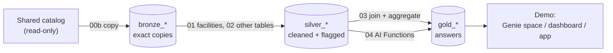

# databricks-fall2026-hackathon

> **CMU Datathon, Fall 2026: Find the right care.** Given a service (dialysis, emergency C-section, NICU, MRI…) and a location in India, recommend the best facilities and show the evidence behind each pick. Brief and checklist: [`docs/CHALLENGE.md`](docs/CHALLENGE.md).
>
> **TODO:** one sentence on what we built and who it helps.

| Teammate | GitHub | Working on |
| --- | --- | --- |
| Brian | | |
| TODO | | |

**In one line:** we copy the Virtue Foundation health data into our own Databricks schema, clean it (flagging every doubtful value instead of hiding it), join it into tables that answer "where should this patient go?", and show each answer with its evidence.

---

## Start here

| If you are... | Do this |
| --- | --- |
| **New to the team** | Steps 1 to 3 below (about 10 minutes) |
| **Setting up the data the first time** | Step 4 (one person, once) |
| **Back to keep working** | Click **Pull** in your Git folder, then open the notebook you own |

**1. Get into the workspace.** Ask Brian to add your email in the team's Databricks workspace, then sign in with that email.

**2. Link GitHub to Databricks.** Click your profile icon (top right) → **Settings → Linked accounts → Add Git credential** → **GitHub**. Either **Link Git account**, or paste a GitHub *classic* personal access token with the `repo` scope.

**3. Clone this repo into Databricks.** **Workspace** → your user folder → **Create → Git folder**:
- URL: `https://github.com/Aryushix/databricks-fall2026-hackathon.git`
- Provider: **GitHub**

**4. Load and clean the data (only once for the whole team).**
1. Open `notebooks/00b_load_virtue_foundation`, choose **Serverless** compute, click **Run all**. **Catalog → workspace → hackathon** now has three `bronze_` tables. If the notebook stays on **Waiting**, run `sql/load_data_sql_editor.sql` in the **SQL Editor** instead.
2. *Recommended:* upload the raw export `dataset.csv` to **Catalog → workspace → hackathon → raw** (never to GitHub). Without it, 30 facilities lose their capability and location fields (see `docs/DATA_CLEANING.md`).
3. Run `notebooks/01_clean_facilities`. It writes `silver_facilities`, one row per facility with a `dq_flags` column.

---

## How the data flows



| Layer | Tables | Made by | Rule |
| --- | --- | --- | --- |
| Source | 3 tables in **Shares received** | Virtue Foundation | Read-only. We never change it. |
| Bronze | `bronze_facilities`, `bronze_india_post_pincode_directory`, `bronze_nfhs_5_...` | `00b` | Exact copies, plus `_source_file` and `_ingested_at` |
| Silver | `silver_facilities` (+ `_dq_summary`) | `01` | Our facility cleaning rules; every doubtful value flagged in `dq_flags` |
| Silver | `silver_<table>` for the other two tables | `02` | Fixed types, trimmed text, no duplicates |
| Gold | `gold_<name>` | `03`, `04` | Joined and summarized tables the demo reads. Every table gets a `COMMENT`. |

**The three source tables:**
- `facilities`: health facility records from the Virtue Foundation.
- `india_post_pincode_directory`: India's postal codes (pincodes) with the district and state each one belongs to.
- `nfhs_5_district_health_...`: district-level health indicators from India's National Family Health Survey (NFHS-5, 2019–21).

The likely join path is **facility → pincode → district → NFHS-5 indicators**. Check this on the real columns. District names often differ in spelling between tables.

---

## What's in this repo

```
notebooks/
  00b_load_virtue_foundation.py  1. Copy the shared data into workspace.hackathon (run once)
  01_clean_facilities.py         2. Clean the facilities → silver_facilities, with data-quality flags
  02_clean_silver.py             3. Clean the PIN directory and NFHS-5 tables → silver_<table>
  03_gold_tables.sql             4. Join and summarize → gold_ tables (write our logic here)
  04_ai_enrich.sql               5. LLM functions on text columns: classify, extract, mask
  05_build_rag_index.py          Optional: search index for a chatbot over documents
  06_ask_and_evaluate.py         Optional: test the chatbot's answers
src/hackathon/
  config.py                      Every table, volume, and model name in one place
  cleaning.py                    The facility cleaning rules (used by notebook 01 and tools/)
  facility_silver.py             Notebook 01's helpers: pick the source, write typed tables
  rag.py                         Chatbot logic, shared by notebook 06 and the app
tools/
  clean_dataset.py               Same cleaning on a laptop: dataset.csv → facilities_cleaned.csv
  facility_crawler.py            Optional, laptop only: fill missing contacts/years from facility websites
tests/test_cleaning.py           Tests for the cleaning rules (made-up rows, no real data)
app/app.py, app.yaml             Optional: demo chat app (Databricks Apps)
eval/questions.jsonl             Optional: test questions for notebook 06
data/README.md                   Where the data lives and where it came from (no data in Git)
sql/load_data_sql_editor.sql     Backup: load the data from the SQL Editor if notebooks won't start
docs/CHALLENGE.md                The datathon brief and our submission checklist
docs/DATA_CLEANING.md            Every cleaning rule and data-quality flag, with counts
docs/databricks-tutorial.md      Our Databricks tutorial: cleaning, AI Functions, RAG, evaluation
.github/                         Automatic code check on every pull request
```

Notebook numbers show run order.

**Where things live:** code is in GitHub. Tables are in Databricks under `workspace.hackathon`, and everyone on the team shares them. Never commit data files.

---

## Running the notebooks

Always attach **Serverless** compute. AI Functions don't work on other compute.

| Notebook | Set these widgets (top of the notebook) | Output |
| --- | --- | --- |
| `00b_load_virtue_foundation` | Nothing | `bronze_` copies of all three tables |
| `01_clean_facilities` | Nothing. Put `dataset.csv` in the `raw` volume first for complete data | `silver_facilities`, `silver_facilities_dq_summary` |
| `02_clean_silver` | `dataset` = `india_post_pincode_directory`, then the NFHS-5 table name; `keys` = its ID column if it has one | `silver_<table>` and a null-count report |
| `03_gold_tables` | Nothing. Edit the SQL. | Our `gold_` tables |
| `04_ai_enrich` | Nothing. Replace the example table and column names. | AI-enriched `gold_` table |

In `02_clean_silver`, put rules that only apply to one table in the cell marked **"4. Your dataset's rules"**.

---

## Team workflow

1. **Pull before you start:** in your Git folder, click the branch name → **Pull**.
2. **Work on your own branch:** branch name → **Create branch**, e.g. `brian/district-join`.
3. **Own a file:** two people editing the same notebook at the same time causes conflicts that are hard to fix. Split work by notebook.
4. **Commit and push:** branch name → write a message → **Commit & Push**.
5. **Merge on GitHub:** open a pull request into `main`. A teammate glances at it, then merge. Everyone pulls.

Never commit data, tokens, or API keys.

---

## How do I...

**...refresh the data?** Rerun `00b_load_virtue_foundation`, then `01`, `02`, and `03`.

**...see what the cleaning changed?** Query `silver_facilities_dq_summary`, or read `docs/DATA_CLEANING.md`. Filter `silver_facilities` on `dq_flags` to see the affected rows.

**...clean the data on my laptop?** `pip install -r tools/requirements.txt`, then `python tools/clean_dataset.py dataset.csv facilities_cleaned.csv`. Keep both files out of Git; `.gitignore` already blocks `*.csv`.

**...run the crawler?** See the Crawler section of `docs/DATA_CLEANING.md`. It runs on a laptop only. Upload its `facilities_enriched.csv` to the `raw` volume, then rerun `01`.

**...change the schema name (e.g. to test without touching the team's tables)?** Change the `schema` widget at the top of any notebook, or the default in `src/hackathon/config.py`.

**...get a table as a CSV?** In a notebook:
```python
spark.table("workspace.hackathon.silver_facilities").toPandas().to_csv(
    "/Volumes/workspace/hackathon/raw/silver_facilities.csv", index=False)
```
Then download it from **Catalog → workspace → hackathon → Volumes → raw**.

**...ask the data questions in plain English?** **Genie Agents** (left sidebar) → **New** → add our `gold_` tables. Good table and column comments make Genie much more accurate.

**...build the demo app?** Optional. See `app/app.py`. Create it under **Compute → Apps → Create app → Custom** with this Git folder as the source path. It also needs the chatbot index from `05`. On Free Edition an app stops 24 hours after its last start, so restart it before the demo.

---

## Troubleshooting

| Problem | Fix |
| --- | --- |
| `01` says it flagged 30 truncated records | It's cleaning the bronze table. Upload `dataset.csv` to the `raw` volume and rerun `01`. |
| `01` fails on `%pip install phonenumbers` | Make sure the notebook is on **Serverless**, then rerun from the top. |
| `00b` can't find the shared catalog | Check that `SOURCE_CATALOG` at the top of `00b` matches the name under **Catalog → Shares received** (`databricks_virtue_foundation_dataset_dais_2026`). |
| "Permission denied" on `workspace.hackathon` | Ask Brian to run: ``GRANT ALL PRIVILEGES ON SCHEMA workspace.hackathon TO `you@andrew.cmu.edu` `` |
| A notebook cell stays on **Waiting** | Compute isn't starting. Click the green circle in the notebook toolbar to see why. To load the data anyway, run `sql/load_data_sql_editor.sql` in the **SQL Editor**. |
| AI Function error | Switch the notebook to **Serverless** compute. |
| Git folder won't clone | Redo step 2 (GitHub credential). Use the `https://` URL. |
| Merge conflict in a notebook | Keep one person's version, then re-apply the other's change by hand. Next time, split files. |
