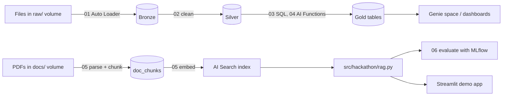

# databricks-fall2026-hackathon

> **TODO:** one sentence on what we built and who it helps.

| Teammate | GitHub | Owns |
| --- | --- | --- |
| TODO | | |

## How it works



| Path | What it is |
| --- | --- |
| `notebooks/` | Run in order, `00` to `06`. Each has `catalog` / `schema` widgets at the top. |
| `src/hackathon/config.py` | Every table, volume, and endpoint name in one place. |
| `src/hackathon/rag.py` | Retrieve + answer. Used by notebook 06 **and** the app, so they always match. |
| `app/app.py`, `app.yaml` | Streamlit chat UI, deployed with Databricks Apps. |
| `pipelines/etl.py` | Optional scheduled version of notebooks 01 and 02, with data-quality rules. |
| `eval/questions.jsonl` | Test questions + expected facts for evaluation. |
| `databricks.yml` | Optional: deploy the pipeline and a refresh job with one command. |
| `data/` | **No data in Git.** Data lives in Unity Catalog volumes; record sources in `data/README.md`. |

---

## 1. Link this repo to Databricks (every teammate, about 5 minutes)

**a. Use one shared workspace.** One person creates it (for example a [Databricks Free Edition](https://docs.databricks.com/aws/en/getting-started/free-edition) account) and invites the others: profile icon → **Settings** → **Workspace admin → Identity and access → Users** → add each teammate's email. Everyone then works on the same tables and the same AI Search index.

**b. Connect your GitHub account.** Profile icon → **Settings → Linked accounts → Git integration** → provider **GitHub**. Either link with the Databricks GitHub App or paste a GitHub personal access token that can read and write this repo.

**c. Clone the repo into your workspace.** **Workspace** → your user folder → **Create → Git folder**:
- Git repository URL: `https://github.com/Aryushix/databricks-fall2026-hackathon.git`
- Git provider: **GitHub**
- Click **Create Git folder**.

**d. Make your own branch.** Click the branch name at the top of the Git folder (the **Git** button) → create `yourname/what-youre-doing`. Commit and push from the same dialog.

> Free Edition limits outbound internet to trusted domains. If the clone fails right away, check step (b) first, then try from a different workspace.

## 2. First-time setup (one person)

1. Open `notebooks/00_setup`, attach **Serverless** compute, click **Run all**. This creates schema `workspace.hackathon` and the volumes `raw`, `docs`, and `checkpoints`.
2. Upload data: **Catalog → workspace → hackathon → raw → Upload to this volume**. Put each dataset in its own subfolder (`raw/orders/`). Put PDFs and other documents in `docs/`.
3. Write down where each dataset came from in `data/README.md`.

## 3. Run the notebooks

Attach every notebook to **Serverless** compute. AI Functions don't work on classic clusters.

| Notebook | What it does | Set these widgets |
| --- | --- | --- |
| `00_setup` | Schema + volumes | – |
| `01_ingest_bronze` | New files in `raw/<dataset>/` → `bronze_<dataset>` (Auto Loader) | `dataset`, `format` |
| `02_clean_silver` | Names, trimming, nulls, dedupe, **your rules** → `silver_<dataset>` | `dataset`, `keys` |
| `03_gold_tables` | Business tables with comments (edit the examples) | – |
| `04_ai_enrich` | `ai_classify`, `ai_extract`, `ai_mask`, `ai_query` on text columns | – |
| `05_build_rag_index` | Parse docs → chunks → AI Search index (rerun after adding docs) | `search_endpoint` |
| `06_ask_and_evaluate` | Ask questions, score answers with MLflow judges | – |

## 4. Team workflow

- **Pull before you start:** Git button → **Pull**.
- **One branch per person.** Push it, open a pull request on GitHub, merge into `main`, and everyone pulls.
- **Split work by file.** Two people editing the same notebook at once makes painful merge conflicts.
- **Never commit data, tokens, or keys.** `.gitignore` blocks common data files. Store keys with Databricks secrets.
- Change names in `src/hackathon/config.py` or in the widgets, never by hard-coding a table name.

## 5. Demo app

1. **Compute → Apps → Create app → Custom**, name it (e.g. `hackathon-demo`).
2. Deploy, using your Git folder as the source code path, e.g. `/Workspace/Users/<you>/databricks-fall2026-hackathon`. Databricks installs `requirements.txt` and runs the command in `app.yaml`.
3. Give the app access to the model and the index. In the app's settings, add these resources: the serving endpoint `databricks-gpt-oss-120b` (Can query) and the AI Search index `workspace.hackathon.doc_chunks_index`. If it still can't read the index, a workspace admin can grant its service principal access:
   ```sql
   GRANT USE CATALOG ON CATALOG workspace TO `<app-service-principal-id>`;
   GRANT USE SCHEMA, SELECT ON SCHEMA workspace.hackathon TO `<app-service-principal-id>`;
   ```
4. On Free Edition, an app stops 24 hours after its last start. **Restart it right before the demo.**

If you changed the catalog, schema, or model, update the matching values in `app.yaml`.

## Configuration

| Setting | Default | Override with |
| --- | --- | --- |
| Catalog | `workspace` | widget `catalog` / env `HACKATHON_CATALOG` |
| Schema | `hackathon` | widget `schema` / env `HACKATHON_SCHEMA` |
| Chat model | `databricks-gpt-oss-120b` | env `HACKATHON_LLM_ENDPOINT` |
| Embedding model | `databricks-qwen3-embedding-0-6b` | env `HACKATHON_EMBEDDING_ENDPOINT` |
| AI Search endpoint | `hackathon-search` | widget `search_endpoint` / env `HACKATHON_SEARCH_ENDPOINT` |

Hosted model names change over time. Check **Serving** in the workspace if a model isn't found.

## Optional: deploy with one command

Requires the [Databricks CLI](https://docs.databricks.com/dev-tools/cli/) on your laptop and `databricks auth login`.

```bash
databricks bundle validate
databricks bundle deploy          # creates the pipeline and the refresh job (dev mode: prefixed with your name)
databricks bundle run refresh     # notebooks 01 → 02 → 03 → 05 on serverless
```

## Troubleshooting

| Problem | Fix |
| --- | --- |
| AI Function or `vector_search` error | Attach **Serverless** compute (not a classic cluster or Pro/Classic SQL warehouse). |
| `01_ingest_bronze` stops with a schema-change error | Expected when new columns appear. Run it again. |
| Can't create an AI Search endpoint on Free Edition | Only one is allowed. Set the `search_endpoint` widget to the one that already exists. |
| Index creation fails | The source table needs Change Data Feed (notebook 05 sets it), and no column may be named `_id`. |
| Pipeline won't start on Free Edition | Only one active pipeline per type. Stop the other one. |
| Model endpoint not found | Check **Serving** for current names, then set `HACKATHON_LLM_ENDPOINT`. |
