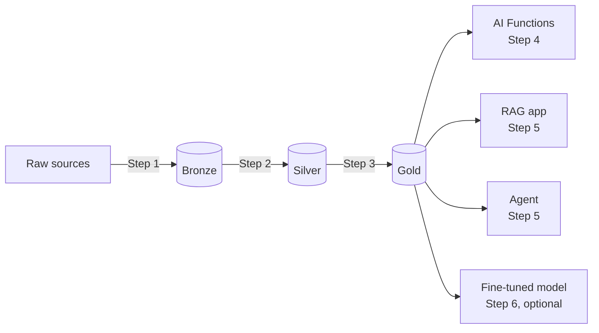

# Databricks Tutorial: Clean, Transform, and Build an LLM App on Your Data

Nov 21, 2026 · Brian · Live, editable version: https://claude.ai/artifact/XmQGoXNAaECLqckn48xc6k

## Overview

On Databricks you almost never train an LLM from scratch. You clean and shape your data into governed tables, then connect an existing foundation model to those tables. Everything in this tutorial lives in one workspace, governed by Unity Catalog, and follows the medallion pattern:

- **Bronze**: raw data, landed as-is, so you can always replay it.
- **Silver**: cleaned, typed, deduplicated, validated.
- **Gold**: business-level tables (joins, aggregates, features), plus the document chunks an LLM will read.

If you know pandas and SQL, you already know most of it. PySpark DataFrames look like pandas, but they are lazy and distributed. Every step below also works in plain SQL.



*MLflow 3 traces and evaluates every LLM option (Step 7). Unity Catalog governs every table, volume, index, model, and agent.*

The top row is data engineering (Steps 1 to 3). Every LLM option in the second row reads the same Gold tables. RAG is highlighted because it's the usual answer to "make an LLM from my data."

### What "make it into an LLM" can mean

Pick the row that matches your goal. Most projects end up at RAG or an agent.

| Goal | What you build | Databricks pieces | Effort |
| --- | --- | --- | --- |
| Run an LLM over every row (classify, extract, summarize) | A batch job that writes AI output into a new column | AI Functions (`ai_query`, `ai_classify`, `ai_extract`) | Low: SQL only |
| A chatbot that answers from your documents or tables | Retrieval-augmented generation (RAG) | `ai_parse_document`, chunking, AI Search (formerly Vector Search), Agent Bricks, Model Serving | Medium |
| An assistant that queries data and calls tools | An agent | Agent Bricks or Agent Framework, Unity Catalog functions as tools, MLflow | Medium to high |
| A model that writes in your domain's style or format | A fine-tuned open model | Serverless GPU compute, MLflow, Model Serving | High: needs labeled data and GPUs |
| Your own LLM from zero | Pretraining | Not realistic for a student or small team | Very high |

The steps below follow that order: ingest, clean, transform, then each LLM option, then evaluation and deployment.

## Setup

Use [Databricks Free Edition](https://docs.databricks.com/aws/getting-started/free-edition) for learning. It is free, serverless-only, and includes notebooks, SQL, pipelines, AI Search, model serving, and Apps. It replaced the old Community Edition in 2025. For the full platform (e.g., Knowledge Assistant, GPU serving), start a paid-account free trial.

1. Sign up, and Databricks creates a workspace for you.
2. Open **New > Notebook**. Attach it to **Serverless** compute (the only option on Free Edition).
3. Create a schema and a volume. Unity Catalog names everything as `catalog.schema.object`. A volume is a governed folder for raw files. Free Edition gives you a catalog named `workspace`.

```sql
CREATE SCHEMA IF NOT EXISTS workspace.tutorial;
CREATE VOLUME IF NOT EXISTS workspace.tutorial.raw;   -- files land at /Volumes/workspace/tutorial/raw/
```

4. Upload a CSV or a few PDFs: **Catalog > workspace > tutorial > raw > Upload to this volume**.

In notebooks you can switch languages per cell with `%sql` or `%python`. The built-in Databricks Assistant can write, explain, and fix code in place.

### Free Edition limits that affect this tutorial

| Resource | Limit |
| --- | --- |
| Compute | Serverless only; outbound internet limited to trusted domains |
| SQL warehouses | 1, size 2X-Small |
| Jobs | 5 concurrent tasks per account |
| Lakeflow pipelines | 1 active pipeline per pipeline type |
| AI Search | 1 endpoint, 1 search unit; no Direct Vector Access |
| Model serving | A few active endpoints; no GPU endpoints, no provisioned throughput |
| Databricks Apps | 3 per account; each stops after 24 hours (restart anytime) |
| Not available | Knowledge Assistant, R and Scala, CDC database connectors |

Go over your daily quota and compute shuts off until the next day. Your data stays. Verifying your identity through LinkedIn raises some limits. Source: [Free Edition limitations](https://docs.databricks.com/aws/en/getting-started/free-edition-limitations).

### Working with GitHub (hackathons and teams)

Connect a GitHub repo with **Git folders** (formerly "Repos"). It clones the repo into your workspace, and from there you branch, commit, push, pull, and resolve merge conflicts in the Databricks UI.

1. Add a GitHub credential: open your user **Settings > Linked accounts > Git integration**. Either link the Databricks GitHub App or paste a GitHub personal access token. Private repos and pushing need a credential.
2. In **Workspace**, open your user folder and click **Create > Git folder**. Paste the repo's HTTPS URL and choose GitHub as the provider.
3. Use the folder's **Git** button to switch branches, review the diff, commit and push, or pull.

| Team practice | Why |
| --- | --- |
| One Git folder per teammate, each on their own branch | Databricks recommends it, so people don't overwrite each other's work. Merge on GitHub with pull requests. |
| Commit code and notebooks, not data | Data belongs in Unity Catalog tables and volumes, which everyone on the workspace can read. |
| Never commit tokens or API keys | Store them in a secret scope and read them with `dbutils.secrets.get("scope", "key")`. |
| Keep the repo small and focused | Databricks advises against large monorepos in Git folders. |
| Clone early on Free Edition | Free Edition limits outbound internet to trusted domains. Check that GitHub works before the clock starts. |

Git folders work over HTTPS only (no SSH) and don't support GPG-signed commits. To redeploy jobs and pipelines from the repo with one command, look at Declarative Automation Bundles (formerly Databricks Asset Bundles), which store them as YAML next to your code. For a weekend hackathon, Git folders are usually enough. Sources: [Databricks Git folders](https://docs.databricks.com/aws/en/repos), [Git operations](https://docs.databricks.com/aws/en/repos/git-operations-with-repos).

## Step 1: Ingest raw data (Bronze)

Land the data exactly as it arrived, plus two lineage columns (source file, load time). Don't clean anything yet. If a cleaning rule turns out wrong, you can rebuild Silver from Bronze.

| Situation | Use |
| --- | --- |
| A few files, one time | UI upload to a volume, then `read_files` |
| New files keep arriving in a folder | Auto Loader (incremental: each file is read once) |
| Data in a SaaS app or database (Salesforce, SharePoint, SQL Server) | Lakeflow Connect managed connectors |
| Already a table somewhere else | Query it directly or use `CREATE TABLE ... AS SELECT` |

### One-time load in SQL

```sql
CREATE OR REPLACE TABLE workspace.tutorial.bronze_orders AS
SELECT
  *,
  _metadata.file_path  AS source_file,
  current_timestamp()  AS ingested_at
FROM read_files(
  '/Volumes/workspace/tutorial/raw/orders/',
  format => 'csv',
  header => true
);
```

### Incremental load with Auto Loader (Python)

Auto Loader remembers which files it has already processed, so rerunning it only picks up new ones. `availableNow` processes everything waiting, then stops, which is cheap and works well on a schedule.

```python
src = "/Volumes/workspace/tutorial/raw/orders/"
chk = "/Volumes/workspace/tutorial/raw/_checkpoints/bronze_orders"

(spark.readStream.format("cloudFiles")
    .option("cloudFiles.format", "csv")
    .option("header", "true")
    .option("cloudFiles.inferColumnTypes", "true")
    .option("cloudFiles.schemaLocation", chk)      # tracks the schema over time
    .load(src)
    .selectExpr("*", "_metadata.file_path AS source_file",
                "current_timestamp() AS ingested_at")
 .writeStream
    .option("checkpointLocation", chk)             # tracks processed files
    .trigger(availableNow=True)
    .toTable("workspace.tutorial.bronze_orders"))
```

If a value doesn't match the inferred schema, Auto Loader puts it in a `_rescued_data` JSON column instead of dropping it. Check that column when you debug bad rows.

For PDFs and other documents (needed for the LLM steps), load the raw bytes with `format => 'binaryFile'`. Step 4 shows how.

## Step 2: Clean the data (Silver)

Silver is where you fix types, standardize text, handle nulls, and remove duplicates. Profile first, then write the rules, then enforce them in a pipeline.

### Profile what you have

```python
df = spark.read.table("workspace.tutorial.bronze_orders")
display(df)                    # the table view has a Data Profile tab
dbutils.data.summarize(df)     # counts, nulls, distinct values, histograms per column

# Prefer pandas syntax? This runs distributed, not on one machine:
psdf = df.pandas_api()
psdf.isna().sum()
```

### The common cleaning steps, in SQL

`try_cast` returns NULL instead of failing the whole query on a bad value. `QUALIFY` filters on a window function, which makes dedup a single clause.

```sql
CREATE OR REPLACE TABLE workspace.tutorial.silver_orders AS
SELECT
  order_id,
  customer_id,
  try_cast(order_ts AS TIMESTAMP)      AS order_ts,     -- fix types
  try_cast(amount AS DECIMAL(10,2))    AS amount,
  lower(trim(email))                   AS email,        -- standardize text
  upper(trim(state))                   AS state,
  coalesce(country, 'US')              AS country,      -- fill nulls
  source_file,
  ingested_at
FROM workspace.tutorial.bronze_orders
WHERE order_id IS NOT NULL                              -- drop unusable rows
QUALIFY row_number() OVER (                             -- dedupe: keep latest copy
  PARTITION BY order_id ORDER BY ingested_at DESC) = 1;
```

### The same steps in PySpark

```python
from pyspark.sql import functions as F, Window

latest = Window.partitionBy("order_id").orderBy(F.col("ingested_at").desc())

silver = (spark.read.table("workspace.tutorial.bronze_orders")
    .filter(F.col("order_id").isNotNull())
    .withColumn("order_ts", F.expr("try_cast(order_ts AS TIMESTAMP)"))
    .withColumn("amount",   F.expr("try_cast(amount AS DECIMAL(10,2))"))
    .withColumn("email",    F.lower(F.trim("email")))
    .withColumn("state",    F.upper(F.trim("state")))
    .fillna({"country": "US"})
    .withColumn("rn", F.row_number().over(latest))
    .filter("rn = 1").drop("rn"))

silver.write.mode("overwrite").saveAsTable("workspace.tutorial.silver_orders")
```

### Clean free text and PII before an LLM sees it

If your text has names, emails, or phone numbers, mask them in Silver so they never reach an index or a prompt. `ai_mask` uses a model to find the entities. For column-level rules (e.g., only some groups see raw emails), use Unity Catalog column masks instead.

```sql
SELECT ticket_id,
       ai_mask(body, array('person', 'email', 'phone')) AS body_masked
FROM workspace.tutorial.silver_tickets;
```

### Enforce the rules with a declarative pipeline

Notebook code is fine while exploring. For anything that runs on a schedule, use **Lakeflow Spark Declarative Pipelines** (formerly Delta Live Tables, "DLT"). You declare tables. The pipeline works out the order, processes only new data, retries, and records data-quality metrics. Create one under **Jobs & Pipelines > Create > ETL pipeline**.

Data-quality rules are called **expectations**. Each one is a SQL boolean with one of three actions:

| Action | Python | SQL | Effect on a bad row |
| --- | --- | --- | --- |
| Warn (default) | `@dp.expect` | `EXPECT (...)` | Kept; failure counted in metrics |
| Drop | `@dp.expect_or_drop` | `... ON VIOLATION DROP ROW` | Removed from the target table |
| Fail | `@dp.expect_or_fail` | `... ON VIOLATION FAIL UPDATE` | Stops that flow's update |

```python
from pyspark import pipelines as dp      # older code: import dlt
from pyspark.sql import functions as F

@dp.table(comment="Raw orders, loaded incrementally")
def bronze_orders():
    return (spark.readStream.format("cloudFiles")
            .option("cloudFiles.format", "csv")
            .option("header", "true")
            .load("/Volumes/workspace/tutorial/raw/orders/"))

@dp.table(comment="Typed, standardized, validated orders")
@dp.expect_or_drop("has_id", "order_id IS NOT NULL")
@dp.expect_or_drop("positive_amount", "amount > 0")
@dp.expect("looks_like_email", "email LIKE '%@%'")
def silver_orders():
    return (spark.readStream.table("bronze_orders")
            .withColumn("amount", F.expr("try_cast(amount AS DECIMAL(10,2))"))
            .withColumn("email", F.lower(F.trim("email"))))
```

The SQL version:

```sql
CREATE OR REFRESH STREAMING TABLE silver_orders (
  CONSTRAINT has_id          EXPECT (order_id IS NOT NULL) ON VIOLATION DROP ROW,
  CONSTRAINT positive_amount EXPECT (amount > 0)           ON VIOLATION DROP ROW,
  CONSTRAINT looks_like_email EXPECT (email LIKE '%@%')
) AS
SELECT order_id,
       try_cast(amount AS DECIMAL(10,2)) AS amount,
       lower(trim(email))               AS email
FROM STREAM(bronze_orders);
```

After a run, open the pipeline and click a table, then **Data quality**, to see how many rows passed or failed each rule. Rules can also be kept in a table and loaded with `@dp.expect_all_or_drop(rules_dict)`, so they are versioned separately from the code. Source: [Manage data quality with pipeline expectations](https://docs.databricks.com/ldp/expectations).

## Step 3: Transform into business tables (Gold)

Gold tables answer specific questions: one row per customer, per day, per product. These are what dashboards, ML models, and LLM agents query. Keep them narrow and well named. An agent picks tables and columns by reading their names and comments.

### Joins and aggregates

```sql
CREATE OR REPLACE TABLE workspace.tutorial.gold_customer_summary
COMMENT 'One row per customer: order count, lifetime value, recency'
AS
SELECT
  c.customer_id,
  c.segment,
  count(o.order_id)                          AS orders,
  coalesce(sum(o.amount), 0)                 AS lifetime_value,
  min(o.order_ts)                            AS first_order_ts,
  max(o.order_ts)                            AS last_order_ts,
  datediff(current_date(), max(o.order_ts))  AS days_since_last_order
FROM workspace.tutorial.silver_customers c
LEFT JOIN workspace.tutorial.silver_orders o USING (customer_id)
GROUP BY c.customer_id, c.segment;
```

### Window functions (running totals, previous values)

```sql
SELECT
  customer_id, order_ts, amount,
  sum(amount)  OVER (PARTITION BY customer_id ORDER BY order_ts) AS running_total,
  lag(order_ts) OVER (PARTITION BY customer_id ORDER BY order_ts) AS prev_order_ts
FROM workspace.tutorial.silver_orders;
```

### Upserts with MERGE

Use MERGE when a batch of changed records has to update an existing table: update rows that match, insert the new ones.

```sql
MERGE INTO workspace.tutorial.silver_customers AS t
USING workspace.tutorial.customer_updates   AS s
  ON t.customer_id = s.customer_id
WHEN MATCHED THEN UPDATE SET *
WHEN NOT MATCHED THEN INSERT *;
```

Inside a declarative pipeline, use **AUTO CDC** instead. It handles out-of-order records, which a hand-written MERGE can get wrong. SCD type 2 keeps every past version of a row with `__START_AT` and `__END_AT` columns, so you get history for free.

```python
dp.create_streaming_table("silver_customers")
dp.create_auto_cdc_flow(
    target="silver_customers",
    source="bronze_customer_changes",
    keys=["customer_id"],
    sequence_by="updated_at",
    stored_as_scd_type=2,      # 1 = overwrite in place, 2 = keep history
)
```

### Gold as a materialized view in the pipeline

A materialized view recomputes from its inputs on each pipeline run, incrementally when it can.

```python
@dp.materialized_view(comment="One row per customer")
def gold_customer_summary():
    return (spark.read.table("silver_orders")
            .groupBy("customer_id")
            .agg(F.count("order_id").alias("orders"),
                 F.sum("amount").alias("lifetime_value")))
```

### Time travel: undo a bad transform

Every write to a Delta table creates a new version. You can query or restore any version still retained.

```sql
DESCRIBE HISTORY workspace.tutorial.silver_orders;                 -- who changed what, when
SELECT * FROM workspace.tutorial.silver_orders VERSION AS OF 3;    -- read an old version
RESTORE TABLE workspace.tutorial.silver_orders TO VERSION AS OF 3; -- roll back
```

### Schedule it

Under **Jobs & Pipelines > Create > Job**, add tasks (a pipeline, a notebook, a SQL file). Set dependencies so Gold runs only after Silver succeeds, then add a schedule or a file-arrival trigger. The same job can later refresh your AI Search index (Step 5) after new documents land.

## Step 4: Run LLMs directly on your tables (AI Functions)

This is the fastest way to use an LLM on your data. AI Functions are SQL functions that call a Databricks-hosted model on every row. There's no endpoint to deploy and no API key, and they work in notebooks, the SQL editor, pipelines, and jobs. They need serverless compute or a serverless SQL warehouse, not classic clusters.

| Function | Use it to |
| --- | --- |
| `ai_parse_document` | Turn PDFs, Word, PowerPoint, and images into structured text with layout (pages, headers, tables) |
| `ai_extract` | Pull fields you define (vendor, total, date) out of text or a parsed document |
| `ai_classify` | Assign one or more of your labels, with optional confidence and rationale |
| `ai_mask` | Redact entities such as names, emails, and phone numbers |
| `ai_summarize`, `ai_translate`, `ai_analyze_sentiment`, `ai_fix_grammar` | Common text tasks |
| `ai_prep_search` (Beta) | Chunk parsed documents for search and RAG (Step 5) |
| `ai_query` | Anything else: your own prompt, any supported model |

Start with a task-specific function when one fits. Use `ai_query` only when none does.

### Parse documents

Supported inputs: PDF, JPG/JPEG, PNG, TIFF, DOC/DOCX, PPT/PPTX.

```sql
CREATE OR REPLACE TABLE workspace.tutorial.parsed_docs AS
SELECT
  path,
  ai_parse_document(content, map('version', '2.0')) AS parsed
FROM read_files('/Volumes/workspace/tutorial/raw/docs/', format => 'binaryFile');
```

### Extract and classify

Both functions return a VARIANT. Read fields from it with the `:` operator.

```sql
SELECT
  path,
  ai_extract(
    parsed,
    '{"vendor": {"type": "string", "description": "Company that issued the invoice"},
      "total":  {"type": "number"},
      "date":   {"type": "string", "description": "Invoice date, YYYY-MM-DD"}}',
    map('version', '2.0')
  ):response AS fields
FROM workspace.tutorial.parsed_docs;

SELECT
  ticket_id,
  ai_classify(
    body_masked,
    '["billing", "bug", "feature_request", "other"]',
    map('version', '2.1')
  ):response[0].value::string AS category
FROM workspace.tutorial.silver_tickets;
```

### Custom prompts with ai\_query

`failOnError => false` keeps a single bad row from failing the whole batch. Each result then carries an error field you can filter on.

```sql
SELECT
  review_id,
  ai_query(
    'databricks-gpt-oss-120b',
    concat('In one sentence, what is this customer unhappy about? Review: ', review_text),
    failOnError => false
  ) AS complaint
FROM workspace.tutorial.silver_reviews;
```

The same functions are available in PySpark (`from pyspark.sql import functions as F`, then `F.expr("ai_classify(...)")`). Write the output to a Gold table so you pay for inference once, not on every query.

### Call a model from Python

The hosted models expose an OpenAI-compatible API. Use **Playground** in the sidebar to compare models before you write any code.

```python
from databricks.sdk import WorkspaceClient

client = WorkspaceClient().serving_endpoints.get_open_ai_client()
resp = client.chat.completions.create(
    model="databricks-gpt-oss-120b",
    messages=[{"role": "user", "content": "Explain the medallion architecture in 2 sentences."}],
)
print(resp.choices[0].message.content)
```

The list of hosted models changes, and older ones are retired on a schedule. Check **Serving** in your workspace for current endpoint names. Sources: [AI Functions](https://docs.databricks.com/en/large-language-models/ai-functions), [ai\_extract](https://docs.databricks.com/sql/language-manual/functions/ai_extract), [ai\_classify](https://docs.databricks.com/en/sql/language-manual/functions/ai_classify).

## Step 5: Build an LLM app on your data (RAG)

Retrieval-augmented generation (RAG) is how you "make an LLM" out of your own data without training one. On each question you search your documents, pass the best passages to a foundation model, and have it answer only from them. The model stays the same. Your data supplies the knowledge, and you can update it daily.

The pipeline, in order:

1. **Parse** documents into text: `ai_parse_document` (Step 4).
2. **Chunk** the text into passages of a few hundred words: `ai_prep_search`.
3. **Index**: AI Search (formerly Vector Search) embeds each chunk and keeps the index in sync with the table.
4. **Retrieve** the top matches for a question: `vector_search()` in SQL or `similarity_search()` in Python.
5. **Generate** an answer from those chunks: `ai_query` or a chat completion call.

### Three ways to build it, easiest first

| Path | You write | Good for | Free Edition |
| --- | --- | --- | --- |
| Knowledge Assistant (Agent Bricks) | Nothing: point it at a volume or index | A cited document Q&A bot in minutes | Not available |
| SQL + Python RAG (below) | About 40 lines | Learning how RAG works; hackathons | Yes (1 AI Search endpoint) |
| Custom agent with the Agent Bricks CLI | An agent project | Tools, memory, multi-step logic, your own UI | Check your workspace |

For Knowledge Assistant, go to **Agents > Create Agent > Knowledge Assistant** and add up to 10 knowledge sources. Syncing can take a few hours.

### 1. Chunk the parsed documents (Gold)

```sql
CREATE OR REPLACE TABLE workspace.tutorial.doc_chunks AS
WITH prepped AS (
  SELECT path, ai_prep_search(parsed) AS prepped
  FROM workspace.tutorial.parsed_docs
)
SELECT
  md5(concat_ws('#', path, chunk.value:chunk_position::STRING)) AS chunk_pk,
  chunk.value:chunk_to_embed::STRING    AS chunk_to_embed,     -- text used for embeddings
  chunk.value:chunk_to_retrieve::STRING AS chunk_to_retrieve,  -- text shown to the LLM
  path                                  AS source_uri
FROM prepped,
     LATERAL variant_explode(prepped:document.contents) AS chunk;

-- AI Search needs Change Data Feed to keep the index in sync
ALTER TABLE workspace.tutorial.doc_chunks
SET TBLPROPERTIES (delta.enableChangeDataFeed = true);
```

### 2. Create the index

```python
%pip install databricks-ai-search
dbutils.library.restartPython()
```

```python
from databricks.ai_search.client import AISearchClient

client = AISearchClient()
client.create_endpoint(name="tutorial-endpoint", endpoint_type="STANDARD")  # takes a few minutes

index = client.create_delta_sync_index(
    endpoint_name="tutorial-endpoint",
    source_table_name="workspace.tutorial.doc_chunks",
    index_name="workspace.tutorial.doc_chunks_index",
    pipeline_type="TRIGGERED",                 # you call index.sync() after new data
    primary_key="chunk_pk",
    embedding_source_column="chunk_to_embed",
    embedding_model_endpoint_name="databricks-qwen3-embedding-0-6b",
)
```

Databricks computes the embeddings for you. Don't name a column `_id`, because that name is reserved. Older tutorials use `databricks-vectorsearch` and `VectorSearchClient`. That package still works, but new projects should install `databricks-ai-search`.

### 3. Ask a question in pure SQL

```sql
WITH retrieved AS (
  SELECT chunk_to_retrieve, source_uri
  FROM vector_search(
    index      => 'workspace.tutorial.doc_chunks_index',
    query_text => 'What is the refund policy?',
    num_results => 5)
)
SELECT ai_query(
  'databricks-gpt-oss-120b',
  concat(
    'Answer using only the context. Cite the source file in brackets. ',
    'If the context does not contain the answer, say you do not know.\n\nContext:\n',
    (SELECT string_agg(concat('[', source_uri, '] ', chunk_to_retrieve), '\n\n---\n\n') FROM retrieved),
    '\n\nQuestion: What is the refund policy?')
) AS answer;
```

### 4. The same thing as a Python function you can evaluate and deploy

The `@mlflow.trace` decorators record each retrieval and LLM call, which Step 7 uses for evaluation and debugging.

```python
import mlflow
from databricks.sdk import WorkspaceClient

llm = WorkspaceClient().serving_endpoints.get_open_ai_client()
index = client.get_index(index_name="workspace.tutorial.doc_chunks_index")

@mlflow.trace(span_type="RETRIEVER")
def retrieve(question: str, k: int = 5):
    hits = index.similarity_search(
        query_text=question,
        columns=["chunk_to_retrieve", "source_uri"],
        num_results=k,
        query_type="HYBRID",          # vector + keyword; helps with IDs and exact terms
    )
    rows = hits["result"]["data_array"]
    return [{"page_content": r[0], "metadata": {"doc_uri": r[1]}} for r in rows]

@mlflow.trace
def answer(question: str) -> str:
    docs = retrieve(question)
    context = "\n\n---\n\n".join(f"[{d['metadata']['doc_uri']}] {d['page_content']}" for d in docs)
    resp = llm.chat.completions.create(
        model="databricks-gpt-oss-120b",
        messages=[
            {"role": "system", "content": "Answer only from the context. Cite sources in brackets. "
                                          "If the context lacks the answer, say so."},
            {"role": "user", "content": f"Context:\n{context}\n\nQuestion: {question}"},
        ],
    )
    return resp.choices[0].message.content

answer("What is the refund policy?")
```

### Questions about tables, not documents

RAG over text doesn't help with "what were sales by region last quarter?" For that, use a **Genie space**: point it at your Gold tables and it writes SQL for plain-English questions. Good table and column comments (Step 3) make it far more accurate. A **Supervisor Agent** in Agent Bricks can route each question to a Knowledge Assistant or a Genie space.

### Going further: a custom agent

When you need tools (call a function, query a table, hit an API), memory, or several steps, build an agent in code. Databricks now recommends the **Agent Bricks CLI** (Beta) for new agents. It scaffolds a project, runs it locally, and deploys it to Agent Runtime, which is serverless and runs on Databricks Apps.

```bash
pip install databricks-agentbricks
databricks auth login --host https://<your-workspace-url> --profile tutorial
agentbricks init              # scaffold a project from a framework template; writes agent.toml
agentbricks dev               # run locally at http://localhost:8000 against Databricks models
agentbricks deploy my-agent   # deploy; you get back a URL for the live agent
```

You can write the agent logic in any framework (OpenAI Agents SDK, LangGraph, plain Python). Agents reach your AI Search index and Unity Catalog functions through Databricks-managed MCP servers, so Unity Catalog permissions still apply. Older guides deploy with `databricks.agents.deploy()` to Model Serving. That still works, but it isn't the recommended path for new agents. Sources: [Create AI Search indexes](https://docs.databricks.com/aws/en/ai-search/create-ai-search), [Query AI Search](https://docs.databricks.com/aws/en/ai-search/query-ai-search), [Knowledge Assistant](https://docs.databricks.com/aws/en/agents/agent-bricks/knowledge-assistant), [Agent Bricks quickstart](https://docs.databricks.com/aws/en/agents/quickstart), [SQL RAG walkthrough (Classmethod, Aug 2026)](https://dev.classmethod.jp/articles/databricks-rag-with-s3/).

## Step 6: Fine-tuning (only when RAG isn't enough)

Fine-tuning changes a model's behavior, not its knowledge. Use it when the model has the facts (from RAG) but answers in the wrong format, tone, or label set every time. If you just need the model to know your data, RAG is cheaper, faster to update, and easier to audit.

Try these in order and stop when quality is good enough:

1. Better prompt with a few examples in it.
2. RAG (Step 5).
3. RAG plus a structured-output format (`responseFormat` in `ai_query`).
4. Fine-tune a small open model on your examples.

### What's available now

The old one-click **Foundation Model Fine-tuning** API (`databricks_genai`) reached end of life on August 14, 2026. Older tutorials that use it no longer run. Databricks now points to **AI Runtime**, launched March 2026. It gives notebooks serverless NVIDIA A10 and H100 GPUs, and you fine-tune with standard open-source libraries such as Hugging Face TRL, PEFT/LoRA, DeepSpeed, or Axolotl. Databricks publishes example notebooks, including LoRA fine-tuning of `gpt-oss-20b` on an H100 and supervised fine-tuning of Qwen2-0.5B with TRL.

### Turn a Gold table into training data

Fine-tuning data is usually one chat example per line (JSONL). Build it straight from a cleaned table of question/answer pairs:

```python
train = spark.sql("""
  SELECT to_json(named_struct('messages', array(
           named_struct('role', 'user',      'content', question),
           named_struct('role', 'assistant', 'content', answer)))) AS value
  FROM workspace.tutorial.gold_qa_pairs
""")
train.coalesce(1).write.mode("overwrite").text("/Volumes/workspace/tutorial/raw/train_jsonl")
```

Hold back 10 to 20 percent of the rows as a test set, then:

1. Open an AI Runtime fine-tuning example notebook and attach it to serverless GPU compute.
2. Point it at your JSONL and train a LoRA adapter on a small model first.
3. Log the run and model with MLflow, then register it in Unity Catalog.
4. Compare it with plain RAG on the same test questions (Step 7). Keep it only if it wins.

**Free Edition:** Databricks has said serverless GPUs are coming to Free Edition, subject to availability. Serving a custom model on a GPU endpoint isn't supported there yet, so plan to fine-tune on a paid trial or skip this step. Sources: [Foundation Model Fine-tuning (EoL)](https://docs.databricks.com/aws/en/large-language-models/foundation-model-training/fine-tune-run-tutorial), [Introducing AI Runtime](https://www.databricks.com/blog/introducing-ai-runtime-scalable-serverless-nvidia-gpus-databricks-training-and-finetuning), [GPU fine-tuning examples](https://docs.databricks.com/aws/machine-learning/sgc-examples/gpu-llms), [What's coming to Free Edition](https://www.databricks.com/blog/whats-coming-next-free-edition).

## Step 7: Evaluate, deploy, and govern

An LLM app isn't done when it answers one question well. You need a test set, scores you can compare between versions, and limits on who can use it and how much it costs. On Databricks that means MLflow 3 for tracing and evaluation, Apps or Agent Runtime for deployment, and Unity Catalog plus Unity Gateway for governance.

### Trace every call

The `@mlflow.trace` decorators from Step 5 already record each retrieval and model call. Open the notebook's **Experiment** to see each request as a tree: question, retrieved chunks, prompt, answer, latency. That's usually the fastest way to see why an answer is wrong. Most of the time the retrieval missed, not the model.

### Score it with LLM judges

Write 20 to 50 real questions with the facts a good answer must contain. Then run built-in judges over your `answer()` function:

```python
import mlflow
from mlflow.genai.scorers import (
    Correctness, RelevanceToQuery, RetrievalGroundedness, Safety, Guidelines)

eval_data = [
    {"inputs": {"question": "What is the refund window?"},
     "expectations": {"expected_facts": ["Refunds are accepted within 30 days of purchase."]}},
    {"inputs": {"question": "Who approves expense reports over $5,000?"},
     "expectations": {"expected_facts": ["The department head approves them."]}},
    # ... more real questions
]

results = mlflow.genai.evaluate(
    data=eval_data,
    predict_fn=answer,                        # called as answer(question=...)
    scorers=[
        Correctness(),                        # matches expected_facts?
        RelevanceToQuery(),                   # answers the actual question?
        RetrievalGroundedness(),              # supported by retrieved chunks? (needs the RETRIEVER span)
        Safety(),
        Guidelines(name="cites_source",
                   guidelines="The answer names at least one source document in brackets."),
    ],
)
```

Rerun the same evaluation after every change (chunking, prompt, model, hybrid search on or off) and compare runs side by side in the Experiment UI. MLflow 3 doesn't run judges automatically, so list the scorers you want. Older code uses `mlflow.evaluate(model_type="databricks-agent")`, which is the MLflow 2 API.

### Deploy

| Option | What you get | Use when |
| --- | --- | --- |
| Scheduled job writing to a table | AI output stored as a column (Step 4) | Batch enrichment, reports, dashboards |
| Agent Runtime via `agentbricks deploy` | An authenticated agent endpoint and optional chat UI | Recommended for new agents |
| Databricks Apps (Streamlit, Dash, Gradio, Flask, FastAPI) | Your own web UI running in the workspace | A demo front end for a hackathon |
| Knowledge Assistant or Genie space | A built-in chat UI, shareable in the workspace | No-code; fastest to show people |

On Free Edition you get up to 3 Apps, and each stops 24 hours after its last start, so restart it before a demo.

### Govern

- **Data access:** Unity Catalog permissions cover the tables, the volume, and the AI Search index. An agent can only retrieve what its user or service principal is allowed to `SELECT`.

```sql
GRANT USE CATALOG ON CATALOG workspace TO `teammates`;
GRANT USE SCHEMA, SELECT ON SCHEMA workspace.tutorial TO `teammates`;
```

- **Model traffic:** **Unity Gateway** (also called Unity AI Gateway, Beta) sits in front of model and MCP calls. It handles rate limits, budgets, guardrails on inputs and outputs, and usage tracking in system tables. Requests to Databricks-hosted models from `ai_query` already go through it. Since November 1, 2026, budgets also count task-specific AI Functions such as `ai_parse_document`.
- **Lineage:** Catalog Explorer shows which tables, pipelines, and notebooks feed each Gold table and index, which helps when an answer traces back to a bad source row.

Sources: [Predefined LLM scorers](https://docs.databricks.com/aws/mlflow3/genai/eval-monitor/predefined-judge-scorers), [Migrate to MLflow 3](https://docs.databricks.com/gcp/en/mlflow3/genai/agent-eval-migration), [Agent Runtime](https://docs.databricks.com/aws/en/agents/deploy/agent-runtime), [Unity Gateway](https://docs.databricks.com/aws/en/ai-gateway/ai-governance), [Unity Gateway release notes](https://docs.databricks.com/gcp/fr/release-notes/unity-gateway/).

## Practice project, pitfalls, and what to learn next

### A weekend project that uses every step

Pick a public dataset that has both documents and tables, so you practice cleaning and RAG together. Two examples:

- **Investment research assistant:** 10-K filings (PDF or HTML) for 10 to 20 companies plus a table of quarterly financials. Ask "what risks did Company X flag about supply chains?" (RAG) and "which companies grew revenue fastest?" (Genie over Gold).
- **Health policy assistant:** public clinical-trial or hospital-quality records plus the PDFs that describe them. Ask questions across both.

Build order:

1. Upload files to a volume and load Bronze tables (Step 1).
2. Clean into Silver with expectations in a declarative pipeline (Step 2).
3. Build two or three Gold tables with table and column comments (Step 3).
4. Enrich a text column with `ai_classify` or `ai_extract` (Step 4).
5. Parse, chunk, and index the documents, then write `answer()` (Step 5).
6. Write 20 test questions and run `mlflow.genai.evaluate` (Step 7).
7. Put a Genie space or a Databricks App in front of it for the demo.

### Common pitfalls

| Symptom | Likely cause | Fix |
| --- | --- | --- |
| AI Function errors on your cluster | Classic compute or a Pro/Classic SQL warehouse | Use serverless compute or a serverless SQL warehouse |
| Index creation fails on the source table | Change Data Feed is off, or a column is named `_id` | Enable CDF; rename the column |
| Answers are vague or wrong | Retrieval missed the right chunk | Check the trace; try `query_type="HYBRID"`, smaller chunks, or metadata filters |
| A tutorial's code won't run | It predates the 2025–2026 renames | `dlt` → `pyspark.pipelines`; Vector Search → AI Search; `databricks_genai` fine-tuning → AI Runtime |
| Unexpected cost or quota cutoff | `ai_query` run over a whole table, more than once | Test on `LIMIT 100`, then write results to a table once |
| Pipeline won't start on Free Edition | Another pipeline of the same type is active | Stop the other one (limit is 1 active per type) |

### Learning path

- **Databricks Free Edition** for hands-on practice, with the built-in Assistant to explain errors.
- **Databricks Academy** self-paced courses on data engineering and generative AI.
- **Certifications** that match this tutorial: Databricks Certified Data Engineer Associate (Steps 1 to 3) and [Databricks Certified Generative AI Engineer Associate](https://www.databricks.com/learn/certification/genai-engineer-associate) (Steps 4 to 7). The GenAI exam was updated on March 18, 2026, and now covers agent development.
