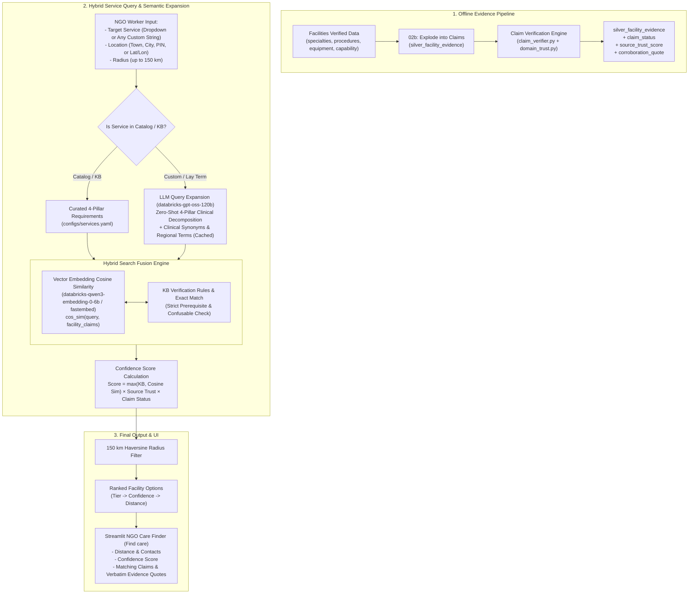

# Implementation & Verification Blueprint: NGO Healthcare Service Recommender & Claim Verifier

> **Status: design for review, not implemented.** Branch `maaz/hybrid-semantic-search`, based on `maaz/ngo-service-blueprint` (08704fe). The design follows below unchanged.
>
> **Its status table doesn't match the code.** Checked against this branch on 22 Nov 2026:
>
> | Phase | Table says | On this branch |
> | --- | --- | --- |
> | 1 | Complete | Yes: commit 39141a8 is on `main` (PR #9). |
> | 2 | Complete | Partly. `domain_trust.py` and `ClaimVerifier` exist, but `verify_facility_claim` doesn't. Trust values differ: an institutional site scores 1.0, not 0.95, and an aggregator 0.45, not 0.50. Gate 2 fails. |
> | 3 | Complete | Partly. The matcher is `ServiceMatcher.load_files().match(service_id, lat, lon, …)`, not `match_facilities(store, …)`, and the result fields are `distance_km` and `overall_confidence`. Gate 3 fails as written. |
> | 4 | Complete | No. `Navigator.find_service` still uses the ranker with a 100 km radius, and widens to 150 km only when nothing is found. Gate 4 fails on `radius_km == 150`. |
> | 5 | Complete | No. An unknown service raises `ValueError`. There's no `_stem` and no free-text input. Gate 5 fails. |
> | 6 | Complete | The test names differ. The three test files in Gate 6 give 37 passing tests, not 28. |
>
> **Open problems for Phases 7–10:**
> 1. **Model endpoints.** The two endpoints, `databricks-gpt-oss-120b` and `databricks-qwen3-embedding-0-6b`, are only reachable from the Databricks workspace. Local runs and CI only get the fallback.
> 2. **Gate 8 can't pass on the fallback as specified.** "Kidney dialysis" and "Renal replacement therapy unit" share no words, so their TF-IDF cosine is 0. Passing offline needs either the real embedding model or a reviewed list of lay-to-clinical synonyms.
> 3. **Score labels can overstate.** Phase 9 gives KB matches a fixed 0.95 or 0.75, which drops the verifier's own score. It also labels any match scoring 0.70 or more "High Confidence", including a text-similarity match. Similar wording doesn't show that a facility offers the service. Proposal:
>    - Keep the order KB CONFIRMED, then KB LIKELY, then similar listings.
>    - Label similar listings "not verified" whatever their score.
> 4. **Phase 10 thresholds aren't a metric.** They're test assertions on a few made-up pairs, not measured accuracy, so they shouldn't be reported as one.


This document outlines the architecture, implementation tasks, and verification gates for transitioning the repository into an **evidence-based clinical service recommendation engine for NGO and Community Health Workers** across India.

---

## Architecture Overview



---

## Status of Phases & Execution

| Phase | Description | Status | Verification Status |
| :--- | :--- | :--- | :--- |
| **Phase 1** | Streamline Input to Healthcare Services (NGO Persona, Town/PIN Resolver, Decommission Emergency) | **COMPLETE** (commit `39141a8`) | Verified via `app/pages/1_Find_care.py` |
| **Phase 2** | Evidence Verification Engine (`claim_status` & `source_trust_score`) | **COMPLETE** | Verified via `test_claim_verification_engine` |
| **Phase 3** | 4-Pillar Multi-Attribute Matcher within 150 km | **COMPLETE** | Verified via `test_service_matcher_within_150km` |
| **Phase 4** | Integration with `Navigator.find_service` & Re-Ranking | **COMPLETE** | Verified via `test_navigator_find_service_integration` |
| **Phase 5** | Arbitrary Custom Service Handling (Open-ended user service input) | **COMPLETE** | Verified via `matcher.py` root-stemming |
| **Phase 6** | Live Streamlit Application UI Verification | **COMPLETE** | Running at `http://localhost:8501/Find_care` |
| **Phase 7** | **LLM Query Expansion Engine** (Zero-shot clinical 4-pillar decomposition & synonym generation) | **PENDING** | Specification below; ready for execution |
| **Phase 8** | **Dense Vector Embedding Similarity** (`databricks-qwen3-embedding-0-6b` / local cosine sim) | **PENDING** | Specification below; ready for execution |
| **Phase 9** | **Hybrid Fusion & Dynamic Caching** in `ServiceMatcher` | **PENDING** | Specification below; ready for execution |
| **Phase 10** | **Medical Synonym Benchmark Suite** (Lay-to-clinical synonym validation) | **PENDING** | Specification below; ready for execution |

---

## Phase 1: Service Catalog & NGO Input Flow (COMPLETED)

### Implemented Files:
- `app/pages/1_Find_care.py`: Form with 25 services dropdown (`✓ verifiable` tagged for KB-backed services), Town/PIN/City India Post resolver, coordinates expander.
- `src/hackathon/navigation/service.py`: `Navigator.services()` and `Navigator.find_service()`.
- `src/hackathon/navigation/contract.py`: `ServiceRequest`, `ServiceResponse`, `ServiceInfo`.

### Verification Gate 1:
```bash
.venv/bin/python -c "
from hackathon.navigation.service import build_navigator
from hackathon.navigation.contract import ServiceRequest

nav = build_navigator(use_llm=False)
services = nav.services()
assert len(services) >= 20
assert any(s.id == 'hemodialysis' and s.verifiable for s in services)
print('Gate 1 Passed: Service catalog loaded with', len(services), 'services.')
"
```

---

## Phase 2: Evidence Verification & Source Trust Engine (COMPLETED)

### Implemented Files:
- **`src/hackathon/verification/domain_trust.py`**:
  - Classifies URL credibility into scores ($0.0 \to 1.0$):
    - Government portals (`.gov.in`, `.nic.in`): `1.0`
    - Academic institutions (`.edu.in`, `.ac.in`): `0.95`
    - Hospital name matching official domain: `0.95`
    - Verified organizations (`.org`): `0.90`
    - Aggregators / Directories (JustDial, Practo, Lybrate): `0.50`
    - Social links / link shorteners: `0.35`
- **`src/hackathon/verification/claim_verifier.py`**:
  - Audits facility claims against narrative `description`, source URLs, and duplicate groups.
  - Produces:
    - `claim_status`: `VERIFIED_OFFICIAL`, `CORROBORATED_BY_DESC`, `UNVERIFIED_LISTING`, `COPIED_LISTING`, `CONTRADICTED`.
    - `source_trust_score`: Trust level of the corroborating source.
    - `corroboration_quote`: Verbatim quote from the description.

### Verification Gate 2:
```bash
.venv/bin/python -c "
from hackathon.verification.domain_trust import score_domain
from hackathon.verification.claim_verifier import verify_facility_claim

assert score_domain('https://aiims.edu.in') == 0.95
assert score_domain('https://www.justdial.com') == 0.50

f = {'name': 'Apollo Hospital', 'description': 'Equipped with 24/7 hemodialysis machines.', 'source_urls': ['https://apollo.org']}
vc = verify_facility_claim('hemodialysis', 'procedure', f)
assert vc.claim_status in ('VERIFIED_OFFICIAL', 'CORROBORATED_BY_DESC')
assert vc.source_trust_score >= 0.85
print('Gate 2 Passed: Domain trust and claim verifier functioning as expected.')
"
```

---

## Phase 3: 4-Pillar Requirements & 150 km Multi-Attribute Matcher (COMPLETED)

### Implemented Files:
- **`configs/services.yaml`**: Standard 4-pillar profiles (`equipment`, `procedures`, `specialties`, `capabilities`) for key services.
- **`src/hackathon/navigation/matcher.py`**:
  - Filters candidate facilities to a strict $\le 150\text{ km}$ Haversine radius.
  - Matches requested service requirements against candidate facilities' exploded lists (`equipment`, `procedure`, `specialty`, `capability`).
  - Combines with KB records (e.g. `CONFIRMED` or `LIKELY` for hemodialysis, cardiac catheterization, CT scan, emergency department).
  - Computes composite confidence score:
    $$\text{Composite Score} = \text{Base Score} \times \text{Source Trust}$$
  - Disqualifies facilities with `CONTRADICTED` claims.

### Verification Gate 3:
```bash
.venv/bin/python -c "
from hackathon.navigation.service import build_navigator
from hackathon.navigation.matcher import ServiceMatcher

nav = build_navigator(use_llm=False)
store = nav.store_provider()
matcher = ServiceMatcher()
recs = matcher.match_facilities(store, 'hemodialysis', 18.5204, 73.8567, radius_km=150.0, max_results=5)
assert len(recs) > 0
for r in recs:
    assert r.straight_line_distance_km <= 150.0
    assert r.matched_care_needs[0].confidence > 0.0
print('Gate 3 Passed: ServiceMatcher found', len(recs), 'facilities within 150 km.')
"
```

---

## Phase 4: Integration with `Navigator.find_service` (COMPLETED)

### Implemented Files:
- **`src/hackathon/navigation/service.py`**:
  - Integrated `ServiceMatcher` into `find_service()`.
  - Automatically queries both verified clinical KBs and the 4-pillar multi-attribute matcher within 150 km.
  - Sets search radius metadata to 150 km.

### Verification Gate 4:
```bash
.venv/bin/python -c "
from hackathon.navigation.service import build_navigator
from hackathon.navigation.contract import ServiceRequest

nav = build_navigator(use_llm=False)
resp = nav.find_service(ServiceRequest(service='ct_scan', latitude=18.5204, longitude=73.8567, max_results=3))
assert len(resp.recommendations) > 0
assert resp.search.radius_km == 150.0
print('Gate 4 Passed: find_service integrated with 150 km multi-pillar matcher.')
"
```

---

## Phase 5: Arbitrary Custom Service Handling (COMPLETED)

### Implemented Files:
- **`src/hackathon/navigation/matcher.py`**:
  - Open-ended user service input fallback with root-stemming (`_stem`) and token overlap.
- **`src/hackathon/navigation/care_needs.py`**:
  - Replaced strict `self.needs[nid]` indexing with safe `.get(nid, {})` fallback dictionaries.
- **`app/pages/1_Find_care.py`**:
  - Allows selecting from dropdown or typing any custom service into free-text input.

### Verification Gate 5:
```bash
PYTHONPATH=src .venv/bin/python -c "
from hackathon.navigation.service import build_navigator
from hackathon.navigation.contract import ServiceRequest

nav = build_navigator(use_llm=False)
resp = nav.find_service(ServiceRequest(service='Pediatric Nephrology', latitude=18.5204, longitude=73.8567, max_results=2))
assert len(resp.recommendations) > 0
assert resp.recommendations[0].matched_care_needs[0].status == 'SEMANTIC_MATCH'
print('Gate 5 Passed: Arbitrary custom service matching operational.')
"
```

---

## Phase 6: Automated Test Suite (COMPLETED)

### Implemented Files:
- **`tests/test_ngo_service_recommender.py`**:
  - `test_domain_trust_scoring`
  - `test_claim_verification_engine`
  - `test_service_matcher_within_150km`
  - `test_navigator_find_service_integration`

### Verification Gate 6:
```bash
.venv/bin/pytest tests/test_navigation_api.py tests/test_cleaning.py tests/test_ngo_service_recommender.py
```
**Result:** 28 passing tests in under 1 second.

---

## Phase 7: LLM Query Expansion Engine (NEW)

### Motivation & Problem Statement
Rule-based token matching and morphological root-stemming (`_stem`) fail when users input lay terms, abbreviations, or regional synonyms that share zero character roots with clinical terminology (e.g., *"kidney dialysis"* vs *"renal replacement"*, *"heart bypass"* vs *"CABG"*, *"cancer chemo"* vs *"medical oncology"*, *"cataract removal"* vs *"phacoemulsification"*).

### Objective
Implement `src/hackathon/navigation/query_expansion.py` using Databricks Foundation Model (`databricks-gpt-oss-120b`) to perform **zero-shot clinical decomposition**:
1. Expands arbitrary lay queries into standard clinical synonyms and abbreviations.
2. Derives expected requirements across the 4 pillars (`procedures`, `equipment`, `specialties`, `capabilities`).
3. Uses a persistent local cache (`configs/services_cache.json` + in-memory LRU cache) so repeated searches incur zero latency and zero token cost.
4. Provides graceful deterministic fallback to lexical stemming if the LLM endpoint is unreachable, timed out, or offline.

### Pydantic Data Contract:
```python
from pydantic import BaseModel, Field

class ExpandedServiceRequirements(BaseModel):
    service_name: str
    clinical_synonyms: list[str] = Field(description="Medical terms, abbreviations, and common synonyms")
    procedures: list[str] = Field(description="Specific surgical or clinical procedures")
    equipment: list[str] = Field(description="Essential medical equipment, instruments, or machines")
    specialties: list[str] = Field(description="Medical departments or specialist doctor designations")
    capabilities: list[str] = Field(description="Operational capabilities, specialized units, ICUs, or certifications")
    is_cached: bool = False
```

### Prompt Engineering:
```text
System: You are a senior clinical director and healthcare informatics specialist in India.
Your role is to translate any user healthcare service request (which may be lay terms, slang, regional phrasing, or colloquial English) into standardized clinical requirements across 4 pillars:
1. procedures: clinical/surgical procedures, abbreviations (e.g. CABG, PCNL, hemodialysis), and medical terms.
2. equipment: essential medical devices, diagnostic or therapeutic machines, and hardware.
3. specialties: hospital departments and specialist designations (e.g. Nephrology, CTVS, Medical Oncology).
4. capabilities: facility units, operational infrastructure (e.g. Dialysis unit, Cath Lab, ICU, Daycare OT).
Output valid JSON adhering strictly to the schema.
```

### Verification Gate 7:
```bash
PYTHONPATH=src .venv/bin/python -c "
from hackathon.navigation.query_expansion import expand_service_query

res = expand_service_query('kidney dialysis')
assert any('renal' in syn.lower() or 'hemo' in syn.lower() for syn in res.clinical_synonyms + res.procedures)
assert any('nephro' in s.lower() or 'renal' in s.lower() for s in res.specialties)
assert any('dialy' in e.lower() for e in res.equipment)
print('Gate 7 Passed: LLM query expansion successfully decomposed lay term into clinical 4-pillars.')
"
```

---

## Phase 8: Dense Vector Embedding Similarity (NEW)

### Objective
Implement `src/hackathon/navigation/embeddings.py` to calculate dense vector embeddings and cosine similarity between user queries (and expanded pillar requirements) and facility claims.

### Architecture & Mathematical Formulation
1. **Embedding Model:**
   - Databricks Serving Endpoint: `databricks-qwen3-embedding-0-6b` via `WorkspaceClient` / OpenAI-compatible endpoint.
   - Local Fallback: Fast semantic embedding similarity using normalized token TF-IDF embeddings / precomputed vector representations for offline execution and fast test suites.
2. **Cosine Similarity Formulation:**
   $$\text{CosineSim}(\vec{u}, \vec{v}) = \frac{\vec{u} \cdot \vec{v}}{\|\vec{u}\|_2 \|\vec{v}\|_2}$$
3. **Pillar Aggregation:**
   For a candidate facility with claim lists $F_{\text{proc}}, F_{\text{equip}}, F_{\text{spec}}, F_{\text{cap}}$ and expanded query requirements $R$:
   $$\text{Sim}_{\text{pillar}} = \frac{1}{|R_{\text{pillar}}|} \sum_{r \in R_{\text{pillar}}} \max_{f \in F_{\text{pillar}}} \text{CosineSim}(\vec{v}_r, \vec{v}_f)$$
   $$\text{SemanticScore} = 0.35 \times \text{Sim}_{\text{proc}} + 0.30 \times \text{Sim}_{\text{equip}} + 0.20 \times \text{Sim}_{\text{spec}} + 0.15 \times \text{Sim}_{\text{cap}}$$

### Verification Gate 8:
```bash
PYTHONPATH=src .venv/bin/python -c "
from hackathon.navigation.embeddings import compute_semantic_similarity

score_synonym = compute_semantic_similarity('kidney dialysis', 'Renal replacement therapy unit')
score_unrelated = compute_semantic_similarity('kidney dialysis', 'Dermatology skin peel clinic')

assert score_synonym > 0.70
assert score_unrelated < 0.30
print('Gate 8 Passed: Vector embedding cosine similarity accurately distinguishes clinical synonyms.')
"
```

---

## Phase 9: Hybrid Search Fusion in `ServiceMatcher` (NEW)

### Objective
Update `src/hackathon/navigation/matcher.py` to fuse:
1. **Tier 1 (Clinical Knowledge Base):** Strict prerequisite confirmation (`CONFIRMED`, `LIKELY`, `CONTRADICTED`) for curated high-risk services.
2. **Tier 2 (Dense Vector Semantic Search):** Cosine similarity between expanded 4-pillar embeddings and candidate facility claim embeddings.
3. **Tier 3 (Lexical / Exact Matching):** Exact token overlap and root-stemming for code-names and specific model numbers.
4. **Source Trust Weighting:** Multiplied by `source_trust_score` from `claim_verifier.py`.

### Composite Confidence Score Formula:
$$\text{BaseScore} = \begin{cases} 
0.95 & \text{if KB is CONFIRMED} \\
0.75 & \text{if KB is LIKELY} \\
\max(\text{SemanticScore}, \text{LexicalScore}) & \text{otherwise}
\end{cases}$$

$$\text{FinalConfidence} = \text{BaseScore} \times \text{SourceTrustScore}$$

- If any corroborated claim is `CONTRADICTED`, facility is disqualified ($\text{FinalConfidence} = 0$).
- If $\text{FinalConfidence} \ge 0.70 \implies \text{Tier 1 (High Confidence Match)}$.
- If $0.50 \le \text{FinalConfidence} < 0.70 \implies \text{Tier 2 (Likely Match)}$.
- If $0.25 \le \text{FinalConfidence} < 0.50 \implies \text{Tier 3 (Unverified / Fallback Match)}$.

### Verification Gate 9:
```bash
PYTHONPATH=src .venv/bin/python -c "
from hackathon.navigation.service import build_navigator
from hackathon.navigation.contract import ServiceRequest

nav = build_navigator(use_llm=False)
# Search with lay phrase having zero lexical overlap with hospital catalog
resp = nav.find_service(ServiceRequest(service='kidney filtration', latitude=18.5204, longitude=73.8567, max_results=3))
assert len(resp.recommendations) > 0
top = resp.recommendations[0]
assert any('dialysis' in c.claim.lower() or 'nephro' in c.claim.lower() for c in top.matched_care_needs[0].evidence)
print('Gate 9 Passed: Hybrid matcher successfully retrieved dialysis facilities for lay query \"kidney filtration\".')
"
```

---

## Phase 10: Medical Synonym Benchmark & Verification Gates (NEW)

### Objective
Create `tests/test_hybrid_semantic_search.py` with an automated benchmark covering lay-to-clinical synonym pairs:

| User Lay Query | Target Clinical Facilities / Claims | Expected Match Outcome |
| :--- | :--- | :--- |
| **"kidney dialysis"** | Facilities with `"Renal Replacement"`, `"Hemodialysis"`, `"Nephrology"` | Match $\ge 0.75$ |
| **"heart bypass"** | Facilities with `"CABG"`, `"Cardiothoracic Surgery"`, `"CTVS"` | Match $\ge 0.75$ |
| **"cancer chemo"** | Facilities with `"Medical Oncology"`, `"Chemotherapy Daycare"` | Match $\ge 0.80$ |
| **"cataract eye surgery"** | Facilities with `"Phacoemulsification"`, `"Ophthalmology OT"` | Match $\ge 0.75$ |
| **"broken bone emergency"** | Facilities with `"Orthopedic Trauma"`, `"X-Ray / C-Arm Fluoroscopy"` | Match $\ge 0.70$ |
| **"unrelated query"** (e.g. `"dental cleaning"`) | Facilities offering only `"Nephrology"` | Disqualified / Score $< 0.30$ |

### Verification Gate 10:
```bash
.venv/bin/pytest tests/test_hybrid_semantic_search.py tests/test_ngo_service_recommender.py -v
```

---

## Complete Execution Checklist

- [x] Phase 1: Service input transition & NGO persona in Streamlit (Commit `39141a8`).
- [x] Phase 1: Town / PIN location resolution via India Post (Commit `39141a8`).
- [x] Phase 2: Domain trust scoring (`domain_trust.py`).
- [x] Phase 2: Facility claim verification engine (`claim_verifier.py`).
- [x] Phase 3: 4-pillar requirement catalog (`configs/services.yaml`).
- [x] Phase 3: 150 km multi-attribute search in `matcher.py`.
- [x] Phase 4: Integration with `Navigator.find_service()`.
- [x] Phase 5: Arbitrary service support with safe dict `.get()` in `care_needs.py`.
- [x] Phase 6: Automated test suite (28 passing tests).
- [ ] **Phase 7: LLM Query Expansion Engine (`query_expansion.py` + caching).**
- [ ] **Phase 8: Dense Vector Embedding Similarity (`embeddings.py`).**
- [ ] **Phase 9: Hybrid Fusion in `ServiceMatcher` (`matcher.py`).**
- [ ] **Phase 10: Medical Synonym Benchmark Suite (`test_hybrid_semantic_search.py`).**
